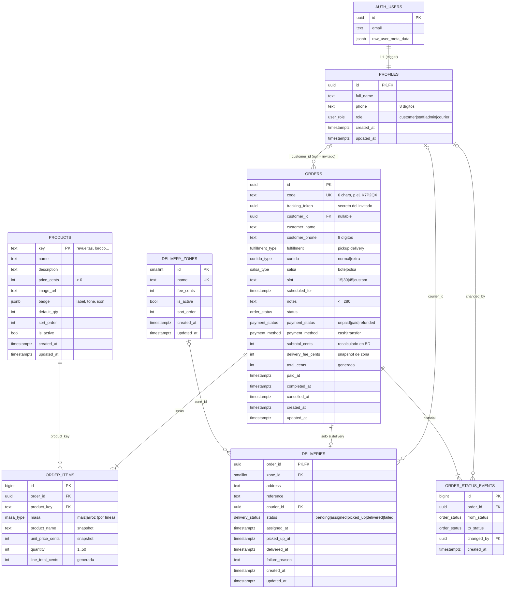

# Diagrama de base de datos — Express Pupusa Ordering App (Supabase)

Basado en `src/lib/checkout.ts` y `docs/SPEC-backend.md` (§5–7). Las migraciones de `supabase/migrations/` se probaron en Postgres 17 con un stub de `auth`.

## Tablas

| Tabla | Para qué |
|---|---|
| `profiles` | 1:1 con `auth.users`. `role` define el acceso (customer/staff/admin/courier). |
| `products` | Catálogo (= `PUPUSAS`). Precios en centavos. Se desactivan con `is_active`, no se borran. |
| `delivery_zones` | Tarifa de envío por zona. Si solo hay una fila, funciona como tarifa fija. |
| `orders` | Pedido. Si `customer_id` es null, es de un invitado (se consulta con `code` + `tracking_token`). |
| `order_items` | Líneas con *snapshot* de nombre y precio. La masa va en cada línea. |
| `deliveries` | Solo para pedidos con `fulfillment = 'delivery'`: dirección, zona, repartidor y estado. |
| `order_status_events` | Auditoría de cambios de estado (la llena un trigger). |
| vistas `earnings_daily`, `earnings_by_product` | Ganancias calculadas a partir de pedidos pagados y no cancelados (`security_invoker`). |

## Cambios respecto al borrador del SPEC

1. **`masa` pasa de `orders` a `order_items`.** La UI la marca como "Global… por defecto", así que el modelo permite mezclar maíz y arroz en un mismo pedido. `unique (order_id, product_key, masa)`.
2. **Nueva tabla `delivery_zones`** en lugar de `deliveries.zone text`. `place_order` toma la tarifa de la BD y guarda una copia en `orders.delivery_fee_cents`, así el cliente nunca manda el monto (D4).
3. **Helpers y triggers en el esquema `private`.** Los `security definer` en `public` quedan expuestos como RPC a `anon`/`authenticated`.
4. **`place_order` como `security invoker`.** Solo la ejecuta `service_role`, que ya ignora RLS, así que no necesita `definer`.
5. **Código de pedido legible y sin colisiones silenciosas.** Usa un alfabeto sin 0/O/1/I/L (31^6 combinaciones) y `place_order` reintenta si el código ya existe. El borrador usaba hex (16^6) sin reintento.
6. **La máquina de estados también se valida en la BD** (`private.order_transition_ok`). Un salto inválido, como `pending → ready`, falla aunque venga del panel.
7. **Sincronización entrega → pedido.** El repartidor no tiene permiso de UPDATE sobre `orders`. Por eso un trigger en `deliveries` cambia el pedido: `picked_up` → `out_for_delivery`, `delivered` → `completed` y `failed` → `cancelled`. Ese trigger también registra `assigned_at`, `picked_up_at` y `delivered_at`. Esto resuelve la tarea T6.6 del SPEC.
8. **Nuevos `check`:** un pedido pagado debe tener `payment_method`, un `pickup` nunca puede estar `out_for_delivery` y un `failed` necesita `failure_reason`.
9. **Grants explícitos por columna.** El staff solo puede cambiar `status`, `payment_status` y `payment_method` (no los montos). El cliente solo puede cambiar `full_name` y `phone` de su perfil. Los proyectos nuevos de Supabase pueden no exponer tablas a la Data API por defecto.
10. **Índices:** `orders (customer_phone, created_at)` para el anti-spam de Q6, un índice parcial de pedidos activos, y un índice para cada FK (`changed_by`, `zone_id`, etc.).

## Pendiente de las preguntas abiertas (SPEC §18)

- **Q4:** si "ganancia" significa utilidad, falta agregar `products.cost_cents` (más un snapshot en `order_items`).
- **Q9:** si se van a cerrar los pedidos fuera de horario, falta una tabla `business_hours (weekday, opens_at, closes_at)` y validarla en `place_order`.
- **Q3:** si se necesita un historial de logins, falta una tabla `login_events`. Si no, basta con `auth.users.last_sign_in_at`.
