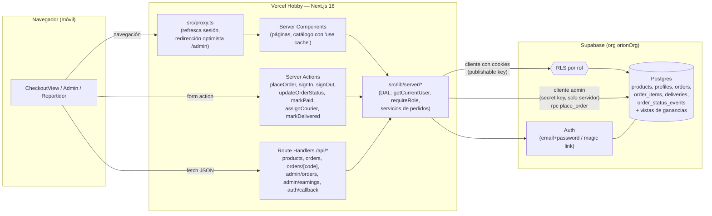
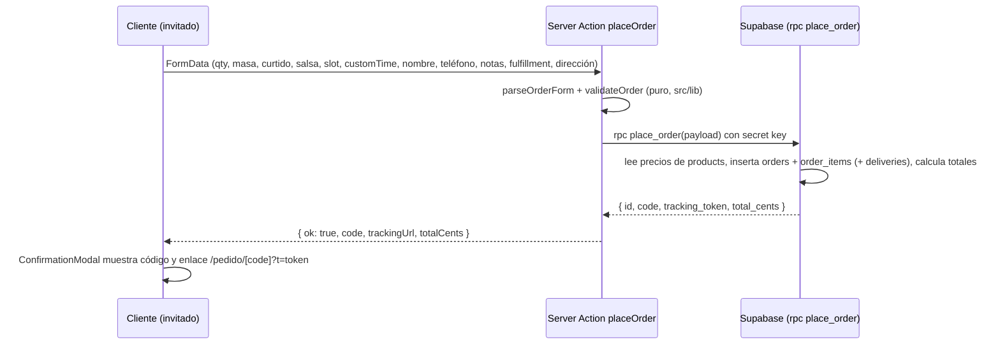
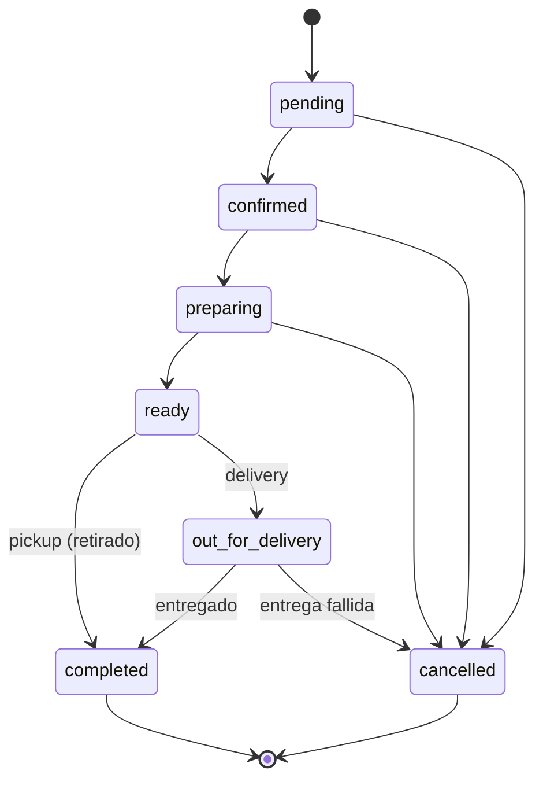

# SPEC — Backend y persistencia para `mcp-parte-01`

> **Tipo:** Spec-Driven Development (SDD). Este documento es la fuente de verdad para implementar el backend con OpenCode, **una tarea a la vez** (sección 17).
> **Estado:** borrador v1 · 2026-11-16 · pendiente de respuestas en la sección 18.
> **Regla para el agente:** antes de escribir código de Next.js, leer la guía relevante en `node_modules/next/dist/docs/` (ver `AGENTS.md`). No leer `.env*` ni `opencode.jsonc` (los bloquea `.opencode/plugin/block-secrets.ts`).

---

## 0. Cómo usar este spec con OpenCode

1. Abre OpenCode en la raíz del proyecto.
2. Pídele **una sola tarea** por vez, por ejemplo: *"Implementa la tarea T2.3 de `docs/SPEC-backend.md`. No hagas otras tareas."*
3. Cuando termine, verifica los **criterios de aceptación** de esa tarea (comandos incluidos) antes de pasar a la siguiente.
4. Si algo del spec no cuadra con el código real, **se corrige primero el spec** y luego el código.
5. Haz commit al cerrar cada fase (mensaje sugerido en cada fase).

Comandos de verificación que se repiten:

```bash
npm run lint
npm run build
npm test            # se agrega en T0.3 (node --test)
```

---

## 1. Objetivo

Convertir el demo de checkout de pupusas (hoy 100 % en estado de React) en una app real y gratuita que:

- **Guarde los pedidos** (órdenes y sus líneas) en una base de datos.
- **Gestione inicios de sesión** para el personal (staff/admin y repartidor) y, opcionalmente, para clientes.
- **Modele entregas**: retiro en el comal (*pickup*) o envío a domicilio (*delivery*), con estado y repartidor.
- **Muestre ganancias** calculadas a partir de los pedidos pagados (nunca escritas a mano).
- Se **publique en Vercel Hobby** (gratis) con **Supabase** (Postgres + Auth + RLS) en el plan gratis.

### 1.1 Alcance (IN)

- Proyecto Supabase nuevo en la organización `orionOrg`.
- Esquema SQL, enums, RLS, vista de ganancias, función para crear pedidos de forma atómica y semilla del catálogo.
- Backend dentro del mismo proyecto Next.js: **Server Actions** (formularios propios) + **Route Handlers** (`src/app/api/**/route.ts`, para API JSON pública y seguimiento).
- Auth con `@supabase/ssr` (cookies) + `src/proxy.ts` para refrescar la sesión.
- Checkout como **invitado** (sin cuenta) que persiste el pedido y devuelve un código de seguimiento.
- Opción de **delivery** en el checkout (dirección, referencia, teléfono).
- Panel `/admin`: lista de pedidos, detalle, cambio de estado, marcar pagado, asignar repartidor, ganancias.
- Vista `/repartidor` mínima: entregas asignadas y marcarlas como entregadas.
- Página `/pedido/[code]` de seguimiento para el cliente.
- Tests con `node:test` para la lógica pura nueva.
- Despliegue a Vercel + configuración de URLs de Auth en Supabase.

### 1.2 Fuera de alcance (OUT)

- Pagos en línea (tarjeta, Wompi, Stripe…). Solo `cash` / `transfer` marcados a mano por el staff.
- Notificaciones por WhatsApp/SMS/email automáticas (se deja un enlace `wa.me` manual).
- Mapas, geolocalización o cálculo de tarifa por distancia (tarifa fija por ahora).
- Inventario/stock, cupones, multi-sucursal, facturación electrónica.
- App móvil nativa, tiempo real (Supabase Realtime) — queda como mejora futura.
- Servidor MCP propio (el nombre del repo es de la serie de talleres).

---

## 2. Estado actual (resumen)

| Aspecto | Hoy |
|---|---|
| Stack | Next.js **16.4.6** App Router, React **19.3**, TypeScript estricto, Tailwind **4.3** (loader `@tailwindcss/turbopack`), ESM. |
| `next.config.ts` | `cacheComponents: true`, `partialPrefetching: true`, Turbopack, imágenes remotas solo de `lh3.googleusercontent.com`. |
| Página | `src/app/page.tsx` (Server Component) pasa `PUPUSAS` a `CheckoutView`. |
| Estado | `src/components/checkout/checkout-view.tsx` (cliente) guarda `qty`, `masa`, `curtido`, `salsa`, `slot`, `customTime`, `name`, `phone`, `notes`. |
| Dominio | `src/lib/checkout.ts`: tipos (`Masa`, `Curtido`, `Salsa`, `Slot`, `Pupusa`, `OrderInput`, `OrderErrors`), catálogo `PUPUSAS` (5 productos, precios en centavos), `computeTotals`, `validateOrder` (teléfono SV de 8 dígitos), `buildSlots`, `slotLabel`, `money` (USD, `es-SV`). |
| Tests | `src/lib/checkout.test.mts` con `node:test`; se corre con `node --test src/lib/checkout.test.mts` (no hay script `test`). Node local: v24. |
| Confirmación | `ConfirmationModal` simulado; **nada se guarda**. `notes` existe en el formulario pero **no** está en `OrderInput`. |
| Backend / BD / Auth | **No existen.** Sin dependencias de Supabase. |
| Git | 1 commit (`create-next-app`) + trabajo sin commitear (componentes, lib, AGENTS.md…). Sin remoto en GitHub. |
| `.gitignore` | Ya ignora `/.next/`, `*.tsbuildinfo`, `.env*`, `.vercel`; `.opencode/.gitignore` ya ignora su `node_modules`. Falta permitir `.env.example` (ver §13). |

> **Prerrequisito antes de T0.1:** hacer commit del trabajo actual (UI del checkout) para que el backend arranque sobre una base limpia.

---

## 3. Decisiones de arquitectura

| # | Decisión | Por qué |
|---|---|---|
| D1 | Backend **en el mismo proyecto** Next.js (Server Actions + Route Handlers). | Un repo, un deploy, sin CORS. Suficiente para pedidos y panel. |
| D2 | **Supabase** nuevo en `orionOrg` (Postgres + Auth + RLS). | Gratis, Auth incluido, RLS protege los datos aunque se use la clave pública. |
| D3 | Pedidos de invitado se crean **solo en el servidor** con la *secret key* llamando a la función SQL `place_order`. `anon` **no** puede insertar directo. | Evita spam directo a la BD y precios manipulados. |
| D4 | **El servidor recalcula precios** desde la tabla `products`. El total que manda el cliente se ignora. | Nunca confiar en el cliente. |
| D5 | Dinero en **enteros (centavos)**, columnas `integer` con `check (>= 0)`. | Convención del proyecto; sin floats. |
| D6 | **Ganancias derivadas**: vista SQL sobre pedidos `paid` y no cancelados. Nada de tabla "ganancias". | Una sola fuente de verdad. |
| D7 | Roles en `profiles.role` (`customer`, `staff`, `admin`, `courier`). Funciones `is_staff()` / `is_admin()` `security definer` para RLS. | RLS simple y sin recursión. |
| D8 | Seguimiento de invitado con `code` corto + `tracking_token` aleatorio (en la URL). | El invitado no tiene sesión; el token evita adivinar pedidos ajenos. |
| D9 | `@supabase/ssr` con cookies; `src/proxy.ts` (Next 16: *Middleware* ahora se llama **Proxy**) solo refresca sesión y hace redirección optimista de `/admin`. La autorización real se repite en cada página/acción (DAL). | Recomendación de Next 16: Proxy no es solución de autorización. |
| D10 | Lógica pura nueva en `src/lib/*.ts` **sin** imports `@/…` ni `server-only`, para poder testearla con `node --test`. El código de servidor va en `src/lib/server/**` (con `import "server-only"`). | Node no resuelve alias de TS; los tests actuales importan `./checkout.ts`. |
| D11 | Catálogo en BD (`products`) con `key` igual a `Pupusa.key`; `PUPUSAS` queda como semilla y *fallback* local. | Precios editables sin redeploy, sin romper la UI. |

### 3.1 Notas de Next.js 16 que afectan este trabajo (leídas de `node_modules/next/dist/docs/`)

- **Proxy reemplaza Middleware** (`01-getting-started/16-proxy.md`, `03-api-reference/03-file-conventions/proxy.md`): archivo `src/proxy.ts` (al nivel de `app/`), exporta `proxy` (o default) y `config.matcher`. Corre en **Node.js runtime** por defecto; **no** se puede poner `export const runtime` ahí (lanza error). Las directivas `use cache` / `use server` no tienen efecto en Proxy. No usarlo para autorización completa.
- **Cache Components está activo** (`cacheComponents: true`), ver `02-guides/authentication-with-cache-components.md`:
  - Leer `cookies()` (sesión) **fuera de un `<Suspense>`** es error de build. Todo componente que lea la sesión va dentro de `<Suspense>`.
  - Un `use cache` normal **no puede** llamar `cookies()`; leer la sesión fuera y pasar solo el `userId`, o usar `use cache: private`.
  - Atajo de migración: `export const instant = false` en una página/layout la deja bloquear en el servidor (útil para `/admin` al inicio).
  - Tras mutar, usar `updateTag(tag)` / `revalidatePath()` / `refresh()` dentro de la Server Action.
- **Route Handlers** (`01-getting-started/15-route-handlers.md`): un `GET` que lee `request`, cookies, headers o BD **no** se prerenderiza. `use cache` no va directo en el cuerpo del handler: extraerlo a una función helper. `ctx.params` es **asíncrono** (`await ctx.params`) y se puede tipar con el helper global `RouteContext<'/api/orders/[code]'>` (tipos generados con `next dev`/`next build`/`next typegen`). No puede haber `route.ts` y `page.tsx` en el mismo segmento.
- **Server Actions** (`02-guides/server-actions.md`): cada acción es un endpoint POST público ⇒ validar entrada y **re-leer la sesión dentro de la acción**. Límite de body 1 MB por defecto; chequeo CSRF por `Origin`/`Host`. `redirect()` lanza excepción: revalidar **antes** de redirigir.
- `forbidden()` / `unauthorized()` requieren `experimental.authInterrupts` ⇒ **no los usamos**; usamos `redirect('/login')` y `notFound()`.

---

## 4. Diagrama de arquitectura



Flujo de un pedido de invitado:



---
## 5. Modelo de datos

> **Actualizado:** el esquema final (diagrama ER y cambios respecto a este borrador) está en [`docs/DB-DIAGRAM.md`](./DB-DIAGRAM.md), y las migraciones aplicables en `supabase/migrations/`. Si difieren de esta sección, mandan esos archivos.

### 5.1 Enums

| Enum | Valores | Origen en el código actual |
|---|---|---|
| `user_role` | `customer`, `staff`, `admin`, `courier` | nuevo |
| `fulfillment_type` | `pickup`, `delivery` | nuevo (hoy todo es retiro en el comal) |
| `order_status` | `pending`, `confirmed`, `preparing`, `ready`, `out_for_delivery`, `completed`, `cancelled` | nuevo |
| `payment_status` | `unpaid`, `paid`, `refunded` | nuevo |
| `payment_method` | `cash`, `transfer` | nuevo |
| `delivery_status` | `pending`, `assigned`, `picked_up`, `delivered`, `failed` | nuevo |
| `masa_type` | `maiz`, `arroz` | `Masa` |
| `curtido_type` | `normal`, `extra` | `Curtido` |
| `salsa_type` | `bote`, `bolsa` | `Salsa` |

`Slot` (`"15" | "30" | "45" | "custom"`) se guarda como `text` con `check`, y la hora real se guarda resuelta en `scheduled_for timestamptz`.

### 5.2 Tablas

**`profiles`** — 1:1 con `auth.users` (se crea solo con un trigger al registrarse).

| Columna | Tipo | Restricciones |
|---|---|---|
| `id` | `uuid` | PK, FK → `auth.users(id)` `on delete cascade` |
| `full_name` | `text` | `check (char_length(full_name) <= 80)` |
| `phone` | `text` | `check (phone ~ '^[0-9]{8}$')`, nullable |
| `role` | `user_role` | `not null default 'customer'` |
| `created_at` / `updated_at` | `timestamptz` | `not null default now()` |

**`products`** — catálogo (semilla = `PUPUSAS`).

| Columna | Tipo | Restricciones |
|---|---|---|
| `key` | `text` | PK, `check (key ~ '^[a-z0-9-]+$')` (= `Pupusa.key`) |
| `name` | `text` | `not null` |
| `description` | `text` | `not null default ''` |
| `price_cents` | `integer` | `not null check (price_cents > 0)` |
| `image_url` | `text` | nullable |
| `badge` | `jsonb` | nullable (`{label, tone, icon?}`) |
| `default_qty` | `integer` | `not null default 0 check (default_qty between 0 and 20)` |
| `sort_order` | `integer` | `not null default 0` |
| `is_active` | `boolean` | `not null default true` |
| `created_at` / `updated_at` | `timestamptz` | |

**`orders`**

| Columna | Tipo | Restricciones |
|---|---|---|
| `id` | `uuid` | PK `default gen_random_uuid()` |
| `code` | `text` | `unique not null`, 6 caracteres A-Z0-9, generado |
| `tracking_token` | `uuid` | `not null default gen_random_uuid()` (secreto del invitado) |
| `customer_id` | `uuid` | FK → `profiles(id)` `on delete set null`, **nullable** (invitado) |
| `customer_name` | `text` | `not null check (char_length(btrim(customer_name)) between 1 and 80)` |
| `customer_phone` | `text` | `not null check (customer_phone ~ '^[0-9]{8}$')` (solo dígitos) |
| `fulfillment` | `fulfillment_type` | `not null default 'pickup'` |
| `masa` / `curtido` / `salsa` | enums | `not null` |
| `slot` | `text` | `not null check (slot in ('15','30','45','custom'))` |
| `scheduled_for` | `timestamptz` | `not null` |
| `notes` | `text` | `check (char_length(notes) <= 280)` |
| `status` | `order_status` | `not null default 'pending'` |
| `payment_status` | `payment_status` | `not null default 'unpaid'` |
| `payment_method` | `payment_method` | nullable |
| `subtotal_cents` | `integer` | `not null check (subtotal_cents >= 0)` |
| `delivery_fee_cents` | `integer` | `not null default 0 check (delivery_fee_cents >= 0)` |
| `total_cents` | `integer` | **generada**: `subtotal_cents + delivery_fee_cents` |
| `paid_at`, `completed_at`, `cancelled_at` | `timestamptz` | los llena un trigger |
| `created_at` / `updated_at` | `timestamptz` | |
| — | — | `check (fulfillment = 'delivery' or delivery_fee_cents = 0)` |

**`order_items`** — líneas con *snapshot* de nombre y precio.

| Columna | Tipo | Restricciones |
|---|---|---|
| `id` | `bigint` | PK identity |
| `order_id` | `uuid` | FK → `orders` `on delete cascade` |
| `product_key` | `text` | FK → `products(key)` `on delete restrict` |
| `product_name` | `text` | `not null` (copia al momento de comprar) |
| `unit_price_cents` | `integer` | `not null check (>= 0)` (copia) |
| `quantity` | `integer` | `not null check (quantity between 1 and 50)` |
| `line_total_cents` | `integer` | **generada**: `unit_price_cents * quantity` |
| — | — | `unique (order_id, product_key)` |

**`deliveries`** — solo existe si `orders.fulfillment = 'delivery'`.

| Columna | Tipo | Restricciones |
|---|---|---|
| `order_id` | `uuid` | PK, FK → `orders` `on delete cascade` |
| `address` | `text` | `not null check (char_length(address) between 5 and 200)` |
| `reference` | `text` | `check (char_length(reference) <= 200)` |
| `zone` | `text` | nullable (colonia / zona) |
| `courier_id` | `uuid` | FK → `profiles(id)` `on delete set null` |
| `status` | `delivery_status` | `not null default 'pending'` |
| `assigned_at`, `picked_up_at`, `delivered_at` | `timestamptz` | |
| `failure_reason` | `text` | |
| `created_at` / `updated_at` | `timestamptz` | |

**`order_status_events`** — historial (auditoría), lo llena un trigger.

| Columna | Tipo |
|---|---|
| `id` | `bigint` PK identity |
| `order_id` | `uuid` FK → `orders` cascade |
| `from_status` / `to_status` | `order_status` |
| `changed_by` | `uuid` (= `auth.uid()`, null si fue el servidor) |
| `created_at` | `timestamptz default now()` |

### 5.3 Vistas de ganancias (derivadas)

"Ganancia" en v1 = **ingreso bruto cobrado** (no hay costos en el sistema; ver pregunta abierta Q4). Solo cuentan pedidos con `payment_status = 'paid'` y `status <> 'cancelled'`. Agrupación por día en `America/El_Salvador`.

- `earnings_daily(day, orders_count, units, subtotal_cents, delivery_fees_cents, gross_cents)`
- `earnings_by_product(day, product_key, product_name, units, revenue_cents)`

Ambas con `security_invoker = true` ⇒ respetan el RLS de quien consulta (solo staff/admin ven datos).

### 5.4 Estados y transiciones de pedido



Las transiciones válidas viven en `src/lib/orders.ts` (`ORDER_TRANSITIONS`, `canTransition(from, to, fulfillment)`) y se validan en el servidor antes de actualizar. `payment_status` es independiente (`unpaid → paid → refunded`).

### 5.5 Mapeo `src/lib/checkout.ts` → BD

| Código (TS) | BD |
|---|---|
| `Pupusa.key` | `products.key` / `order_items.product_key` |
| `Pupusa.name` | `products.name` / `order_items.product_name` (snapshot) |
| `Pupusa.priceCents` | `products.price_cents` / `order_items.unit_price_cents` (snapshot) |
| `Pupusa.desc` | `products.description` |
| `Pupusa.img` | `products.image_url` |
| `Pupusa.badge` | `products.badge` (jsonb) |
| `Pupusa.defaultQty` | `products.default_qty` |
| `Masa` / `Curtido` / `Salsa` | `masa_type` / `curtido_type` / `salsa_type` |
| `Slot` + `customTime` | `orders.slot` + `orders.scheduled_for` (resuelto en servidor) |
| `OrderInput.qty` | filas de `order_items` (solo cantidades > 0) |
| `OrderInput.name` / `.phone` | `orders.customer_name` / `orders.customer_phone` (solo dígitos) |
| `notes` (hoy solo en UI) | `orders.notes` |
| `computeTotals().totalCents` | **solo para mostrar**; la BD recalcula `subtotal_cents` en `place_order` |
| *(nuevo)* `fulfillment`, `address`, `reference`, `zone` | `orders.fulfillment` + `deliveries.*` |

---

## 6. Políticas RLS

RLS **activado en todas las tablas**. Helpers `security definer` con `set search_path = ''`:

- `public.current_role_name()` → rol del usuario actual (o `null`).
- `public.is_staff()` → `role in ('staff','admin')`.
- `public.is_admin()` → `role = 'admin'`.
- `public.is_order_owner(order_id)` / `public.is_order_courier(order_id)` → evitan recursión entre políticas de `orders` y `deliveries`.

| Tabla | `anon` (invitado) | `customer` | `courier` | `staff` | `admin` |
|---|---|---|---|---|---|
| `products` | SELECT si `is_active` | SELECT si `is_active` | SELECT si `is_active` | SELECT todo | SELECT/INSERT/UPDATE/DELETE |
| `profiles` | — | SELECT/UPDATE propio (`full_name`, `phone`; **no** `role`) | igual que customer | SELECT todos | SELECT todos; cambiar `role` solo vía servidor (secret key) |
| `orders` | — (crea vía `place_order` en el servidor) | SELECT propios (`customer_id = auth.uid()`) | SELECT si tiene la entrega asignada | SELECT/UPDATE todos | igual que staff |
| `order_items` | — | SELECT si ve el pedido | SELECT si ve el pedido | SELECT | SELECT |
| `deliveries` | — | SELECT de sus pedidos | SELECT/UPDATE las asignadas (no puede cambiar `courier_id`) | SELECT/UPDATE todas | igual que staff |
| `order_status_events` | — | — | — | SELECT | SELECT |
| vistas `earnings_*` | — | (vacías por RLS) | (vacías) | SELECT | SELECT |
| `rpc place_order` | ❌ | ❌ | ❌ | ❌ | ❌ — solo `service_role` |

Nadie puede hacer `DELETE` de pedidos desde el cliente (se cancelan). Los invitados consultan su pedido mediante `GET /api/orders/[code]?t=<tracking_token>`, que el servidor resuelve con la secret key y devuelve **solo campos públicos**.

---

## 7. Migraciones SQL (borrador propuesto)

> **Actualizado:** el esquema final (diagrama ER y cambios respecto a este borrador) está en [`docs/DB-DIAGRAM.md`](./DB-DIAGRAM.md), y las migraciones aplicables en `supabase/migrations/`. Si difieren de esta sección, mandan esos archivos.

Ubicación: `supabase/migrations/`. Aplicar en orden desde el **SQL Editor** de Supabase o con el MCP de Supabase (`apply_migration`). Son borradores: revisar con `get_advisors` (security/performance) después de aplicar.

### 7.1 `supabase/migrations/20261116000100_schema.sql`

```sql
-- Enums
create type public.user_role        as enum ('customer','staff','admin','courier');
create type public.fulfillment_type as enum ('pickup','delivery');
create type public.order_status     as enum ('pending','confirmed','preparing','ready','out_for_delivery','completed','cancelled');
create type public.payment_status   as enum ('unpaid','paid','refunded');
create type public.payment_method   as enum ('cash','transfer');
create type public.delivery_status  as enum ('pending','assigned','picked_up','delivered','failed');
create type public.masa_type        as enum ('maiz','arroz');
create type public.curtido_type     as enum ('normal','extra');
create type public.salsa_type       as enum ('bote','bolsa');

-- updated_at genérico
create or replace function public.set_updated_at()
returns trigger language plpgsql set search_path = '' as $$
begin
  new.updated_at := now();
  return new;
end $$;

-- Código corto de pedido (6 caracteres)
create or replace function public.generate_order_code()
returns text language sql volatile set search_path = '' as $$
  select upper(substr(replace(gen_random_uuid()::text, '-', ''), 1, 6));
$$;

create table public.profiles (
  id         uuid primary key references auth.users(id) on delete cascade,
  full_name  text check (char_length(full_name) <= 80),
  phone      text check (phone ~ '^[0-9]{8}$'),
  role       public.user_role not null default 'customer',
  created_at timestamptz not null default now(),
  updated_at timestamptz not null default now()
);

create table public.products (
  key         text primary key check (key ~ '^[a-z0-9-]+$'),
  name        text not null,
  description text not null default '',
  price_cents integer not null check (price_cents > 0),
  image_url   text,
  badge       jsonb,
  default_qty integer not null default 0 check (default_qty between 0 and 20),
  sort_order  integer not null default 0,
  is_active   boolean not null default true,
  created_at  timestamptz not null default now(),
  updated_at  timestamptz not null default now()
);

create table public.orders (
  id                 uuid primary key default gen_random_uuid(),
  code               text not null unique default public.generate_order_code(),
  tracking_token     uuid not null default gen_random_uuid(),
  customer_id        uuid references public.profiles(id) on delete set null,
  customer_name      text not null check (char_length(btrim(customer_name)) between 1 and 80),
  customer_phone     text not null check (customer_phone ~ '^[0-9]{8}$'),
  fulfillment        public.fulfillment_type not null default 'pickup',
  masa               public.masa_type not null,
  curtido            public.curtido_type not null,
  salsa              public.salsa_type not null,
  slot               text not null check (slot in ('15','30','45','custom')),
  scheduled_for      timestamptz not null,
  notes              text check (char_length(notes) <= 280),
  status             public.order_status not null default 'pending',
  payment_status     public.payment_status not null default 'unpaid',
  payment_method     public.payment_method,
  subtotal_cents     integer not null check (subtotal_cents >= 0),
  delivery_fee_cents integer not null default 0 check (delivery_fee_cents >= 0),
  total_cents        integer generated always as (subtotal_cents + delivery_fee_cents) stored,
  paid_at            timestamptz,
  completed_at       timestamptz,
  cancelled_at       timestamptz,
  created_at         timestamptz not null default now(),
  updated_at         timestamptz not null default now(),
  constraint pickup_has_no_fee check (fulfillment = 'delivery' or delivery_fee_cents = 0)
);
create index orders_created_at_idx on public.orders (created_at desc);
create index orders_status_idx     on public.orders (status);
create index orders_customer_idx   on public.orders (customer_id);
create index orders_paid_at_idx    on public.orders (paid_at) where payment_status = 'paid';

create table public.order_items (
  id               bigint generated always as identity primary key,
  order_id         uuid not null references public.orders(id) on delete cascade,
  product_key      text not null references public.products(key) on delete restrict,
  product_name     text not null,
  unit_price_cents integer not null check (unit_price_cents >= 0),
  quantity         integer not null check (quantity between 1 and 50),
  line_total_cents integer generated always as (unit_price_cents * quantity) stored,
  unique (order_id, product_key)
);
create index order_items_product_idx on public.order_items (product_key);

create table public.deliveries (
  order_id       uuid primary key references public.orders(id) on delete cascade,
  address        text not null check (char_length(address) between 5 and 200),
  reference      text check (char_length(reference) <= 200),
  zone           text,
  courier_id     uuid references public.profiles(id) on delete set null,
  status         public.delivery_status not null default 'pending',
  assigned_at    timestamptz,
  picked_up_at   timestamptz,
  delivered_at   timestamptz,
  failure_reason text,
  created_at     timestamptz not null default now(),
  updated_at     timestamptz not null default now()
);
create index deliveries_courier_idx on public.deliveries (courier_id);

create table public.order_status_events (
  id          bigint generated always as identity primary key,
  order_id    uuid not null references public.orders(id) on delete cascade,
  from_status public.order_status,
  to_status   public.order_status not null,
  changed_by  uuid,
  created_at  timestamptz not null default now()
);
create index order_status_events_order_idx on public.order_status_events (order_id);

-- updated_at
create trigger profiles_updated_at   before update on public.profiles   for each row execute function public.set_updated_at();
create trigger products_updated_at   before update on public.products   for each row execute function public.set_updated_at();
create trigger orders_updated_at     before update on public.orders     for each row execute function public.set_updated_at();
create trigger deliveries_updated_at before update on public.deliveries for each row execute function public.set_updated_at();

-- Perfil automático al registrarse
create or replace function public.handle_new_user()
returns trigger language plpgsql security definer set search_path = '' as $$
begin
  insert into public.profiles (id, full_name)
  values (new.id, nullif(new.raw_user_meta_data ->> 'full_name', ''));
  return new;
end $$;
create trigger on_auth_user_created
  after insert on auth.users for each row execute function public.handle_new_user();

-- Marcas de tiempo e historial de estado
create or replace function public.orders_track_changes()
returns trigger language plpgsql security definer set search_path = '' as $$
begin
  if new.status is distinct from old.status then
    if new.status = 'completed' then new.completed_at := now(); end if;
    if new.status = 'cancelled' then new.cancelled_at := now(); end if;
    insert into public.order_status_events (order_id, from_status, to_status, changed_by)
    values (new.id, old.status, new.status, auth.uid());
  end if;
  if new.payment_status = 'paid' and old.payment_status is distinct from 'paid' then
    new.paid_at := now();
  end if;
  return new;
end $$;
create trigger orders_track_changes
  before update on public.orders for each row execute function public.orders_track_changes();
```

### 7.2 `supabase/migrations/20261116000200_rls.sql`

```sql
-- Helpers (security definer: leen profiles sin pasar por RLS)
create or replace function public.current_role_name()
returns public.user_role language sql stable security definer set search_path = '' as $$
  select role from public.profiles where id = auth.uid();
$$;

create or replace function public.is_staff()
returns boolean language sql stable security definer set search_path = '' as $$
  select coalesce((select role in ('staff','admin') from public.profiles where id = auth.uid()), false);
$$;

create or replace function public.is_admin()
returns boolean language sql stable security definer set search_path = '' as $$
  select coalesce((select role = 'admin' from public.profiles where id = auth.uid()), false);
$$;

create or replace function public.is_order_owner(p_order_id uuid)
returns boolean language sql stable security definer set search_path = '' as $$
  select exists (select 1 from public.orders o where o.id = p_order_id and o.customer_id = auth.uid());
$$;

create or replace function public.is_order_courier(p_order_id uuid)
returns boolean language sql stable security definer set search_path = '' as $$
  select exists (select 1 from public.deliveries d where d.order_id = p_order_id and d.courier_id = auth.uid());
$$;

alter table public.profiles            enable row level security;
alter table public.products            enable row level security;
alter table public.orders              enable row level security;
alter table public.order_items         enable row level security;
alter table public.deliveries          enable row level security;
alter table public.order_status_events enable row level security;

-- Defensa extra: anon nunca escribe directo
revoke insert, update, delete on all tables in schema public from anon;

-- products
create policy "products: leer activos" on public.products
  for select to anon, authenticated using (is_active or (select public.is_staff()));
create policy "products: admin inserta" on public.products
  for insert to authenticated with check ((select public.is_admin()));
create policy "products: admin edita" on public.products
  for update to authenticated using ((select public.is_admin())) with check ((select public.is_admin()));
create policy "products: admin borra" on public.products
  for delete to authenticated using ((select public.is_admin()));

-- profiles
create policy "profiles: ver propio o staff" on public.profiles
  for select to authenticated using (id = (select auth.uid()) or (select public.is_staff()));
create policy "profiles: editar propio" on public.profiles
  for update to authenticated using (id = (select auth.uid())) with check (id = (select auth.uid()));
-- El rol no se puede cambiar desde el cliente: solo columnas permitidas
revoke update on public.profiles from authenticated;
grant update (full_name, phone) on public.profiles to authenticated;

-- orders (sin INSERT/DELETE para clientes: se crean con place_order)
create policy "orders: ver propios, asignados o staff" on public.orders
  for select to authenticated using (
    customer_id = (select auth.uid())
    or (select public.is_staff())
    or public.is_order_courier(id)
  );
create policy "orders: staff actualiza" on public.orders
  for update to authenticated using ((select public.is_staff())) with check ((select public.is_staff()));

-- order_items
create policy "order_items: ver si ve el pedido" on public.order_items
  for select to authenticated using (
    (select public.is_staff()) or public.is_order_owner(order_id) or public.is_order_courier(order_id)
  );

-- deliveries
create policy "deliveries: ver" on public.deliveries
  for select to authenticated using (
    (select public.is_staff()) or courier_id = (select auth.uid()) or public.is_order_owner(order_id)
  );
create policy "deliveries: staff o repartidor asignado actualiza" on public.deliveries
  for update to authenticated
  using ((select public.is_staff()) or courier_id = (select auth.uid()))
  with check ((select public.is_staff()) or courier_id = (select auth.uid()));

-- El repartidor no puede reasignarse ni tocar la dirección
create or replace function public.deliveries_guard()
returns trigger language plpgsql set search_path = '' as $$
begin
  if auth.uid() is not null and not public.is_staff() then
    if new.courier_id is distinct from old.courier_id
       or new.address is distinct from old.address
       or new.reference is distinct from old.reference then
      raise exception 'Solo el staff puede cambiar repartidor o dirección';
    end if;
  end if;
  return new;
end $$;
create trigger deliveries_guard before update on public.deliveries
  for each row execute function public.deliveries_guard();

-- order_status_events
create policy "status_events: staff lee" on public.order_status_events
  for select to authenticated using ((select public.is_staff()));
```

### 7.3 `supabase/migrations/20261116000300_place_order_and_earnings.sql`

```sql
-- Crea pedido + líneas (+ entrega) de forma atómica y RECALCULA precios desde products.
-- Solo la llama el servidor (secret key). El servidor decide customer_id y delivery_fee_cents.
create or replace function public.place_order(payload jsonb)
returns table (id uuid, code text, tracking_token uuid, total_cents integer)
language plpgsql security definer set search_path = '' as $$
declare
  v_order_id uuid;
  v_subtotal integer := 0;
  v_item     jsonb;
  v_product  public.products%rowtype;
  v_qty      integer;
  v_fulfillment public.fulfillment_type := (payload ->> 'fulfillment')::public.fulfillment_type;
begin
  if jsonb_typeof(payload -> 'items') <> 'array' or jsonb_array_length(payload -> 'items') = 0 then
    raise exception 'EMPTY_ORDER' using errcode = '22023';
  end if;

  insert into public.orders (
    customer_id, customer_name, customer_phone, fulfillment, masa, curtido, salsa,
    slot, scheduled_for, notes, subtotal_cents, delivery_fee_cents
  ) values (
    nullif(payload ->> 'customer_id', '')::uuid,
    btrim(payload ->> 'customer_name'),
    payload ->> 'customer_phone',
    v_fulfillment,
    (payload ->> 'masa')::public.masa_type,
    (payload ->> 'curtido')::public.curtido_type,
    (payload ->> 'salsa')::public.salsa_type,
    payload ->> 'slot',
    (payload ->> 'scheduled_for')::timestamptz,
    nullif(btrim(payload ->> 'notes'), ''),
    0,
    case when v_fulfillment = 'delivery' then coalesce((payload ->> 'delivery_fee_cents')::integer, 0) else 0 end
  ) returning orders.id into v_order_id;

  for v_item in select * from jsonb_array_elements(payload -> 'items') loop
    v_qty := (v_item ->> 'quantity')::integer;
    select * into v_product from public.products p
      where p.key = v_item ->> 'product_key' and p.is_active;
    if not found then
      raise exception 'UNKNOWN_PRODUCT:%', v_item ->> 'product_key' using errcode = '22023';
    end if;
    insert into public.order_items (order_id, product_key, product_name, unit_price_cents, quantity)
    values (v_order_id, v_product.key, v_product.name, v_product.price_cents, v_qty);
    v_subtotal := v_subtotal + v_product.price_cents * v_qty;
  end loop;

  update public.orders o set subtotal_cents = v_subtotal where o.id = v_order_id;

  if v_fulfillment = 'delivery' then
    insert into public.deliveries (order_id, address, reference, zone)
    values (v_order_id, btrim(payload -> 'delivery' ->> 'address'),
            nullif(btrim(payload -> 'delivery' ->> 'reference'), ''),
            nullif(btrim(payload -> 'delivery' ->> 'zone'), ''));
  end if;

  insert into public.order_status_events (order_id, from_status, to_status, changed_by)
  values (v_order_id, null, 'pending', null);

  return query select o.id, o.code, o.tracking_token, o.total_cents from public.orders o where o.id = v_order_id;
end $$;

revoke execute on function public.place_order(jsonb) from public, anon, authenticated;
grant  execute on function public.place_order(jsonb) to service_role;

-- Ganancias derivadas (respetan RLS del que consulta)
create or replace view public.earnings_daily with (security_invoker = true) as
select
  (o.paid_at at time zone 'America/El_Salvador')::date as day,
  count(*)::integer                                     as orders_count,
  coalesce(sum(i.units), 0)::integer                    as units,
  sum(o.subtotal_cents)::integer                        as subtotal_cents,
  sum(o.delivery_fee_cents)::integer                    as delivery_fees_cents,
  sum(o.total_cents)::integer                           as gross_cents
from public.orders o
left join lateral (
  select sum(oi.quantity) as units from public.order_items oi where oi.order_id = o.id
) i on true
where o.payment_status = 'paid' and o.status <> 'cancelled'
group by 1;

create or replace view public.earnings_by_product with (security_invoker = true) as
select
  (o.paid_at at time zone 'America/El_Salvador')::date as day,
  oi.product_key,
  oi.product_name,
  sum(oi.quantity)::integer          as units,
  sum(oi.line_total_cents)::integer  as revenue_cents
from public.order_items oi
join public.orders o on o.id = oi.order_id
where o.payment_status = 'paid' and o.status <> 'cancelled'
group by 1, 2, 3;

revoke all on public.earnings_daily, public.earnings_by_product from anon;
```

> Nota: el `insert` inicial del evento `pending` no lo hace el trigger (es `before update`), por eso va dentro de `place_order`.

### 7.4 `supabase/seed.sql` (catálogo)

Generar con un script o a mano desde `PUPUSAS` (las URLs de imagen se copian tal cual de `src/lib/checkout.ts`):

```sql
insert into public.products (key, name, description, price_cents, image_url, badge, default_qty, sort_order) values
  ('revueltas', 'Revuelta', 'Chicharrón de la casa, frijol colado y quesillo derretido.', 135, '', '{"label":"Más pedida","tone":"popular","icon":"star"}', 2, 1),
  ('loroco', 'Queso con Loroco', 'Quesillo artesanal cremoso y flor de loroco fresca fragante.', 150, '', '{"label":"Favorito","tone":"neutral"}', 1, 2),
  ('frijol', 'Frijol con Queso', 'Frijoles rojos de seda fritos a fuego lento con suave queso.', 125, '', '{"label":"Clásico","tone":"neutral"}', 0, 3),
  ('chicharron', 'Chicharrón con Queso', 'Chicharrón molido sazonado con tomate criollo y quesillo.', 140, '', null, 0, 4),
  ('especial', 'Jalapeño, Queso y Ayote', 'Toque picantito con ayotillo tierno rallado y quesillo abundante.', 175, '', '{"label":"Especial","tone":"special","icon":"whatshot"}', 0, 5)
on conflict (key) do update set
  name = excluded.name, description = excluded.description, price_cents = excluded.price_cents,
  image_url = excluded.image_url, badge = excluded.badge, default_qty = excluded.default_qty,
  sort_order = excluded.sort_order;
```

### 7.5 Primer admin

Después de registrarse con su email en `/login`:

```sql
update public.profiles set role = 'admin' where id = (select id from auth.users where email = '<email-del-admin>');
```

---
## 8. Capa de servidor (estructura de archivos nueva)

```
src/
  proxy.ts                         # Next 16 Proxy: refresca sesión Supabase + redirección optimista /admin, /repartidor
  lib/
    checkout.ts                    # (existente) se extiende: fulfillment, notes, address…
    orders.ts                      # NUEVO puro: parseOrderRequest, buildPlaceOrderPayload, resolveScheduledFor, ORDER_TRANSITIONS, canTransition, labels
    earnings.ts                    # NUEVO puro: summarizeEarnings(rows), rangos de fechas
    orders.test.mts               # NUEVO tests
    earnings.test.mts             # NUEVO tests
    database.types.ts             # GENERADO por Supabase (no editar a mano)
    server/
      env.ts                       # lee y valida env vars (import "server-only")
      supabase/
        server.ts                  # createServerClient (@supabase/ssr) con cookies()
        admin.ts                   # createClient con SUPABASE_SECRET_KEY (solo servidor)
        public.ts                  # cliente sin cookies (publishable key) para lecturas públicas cacheables
        proxy.ts                   # updateSession(request) usado por src/proxy.ts
      auth.ts                      # DAL: getCurrentUser(), requireRole(...roles)
      products.ts                  # getProducts() con 'use cache' + cacheTag('products')
      orders.ts                    # createOrder, getOrderByTracking, listOrders, getOrder, updateStatus, markPaid, assignCourier
      earnings.ts                  # getEarnings(from, to)
  app/
    page.tsx                       # (existente) lee productos de BD (fallback PUPUSAS)
    actions/
      orders.ts                    # 'use server': placeOrder
      auth.ts                      # 'use server': signInWithPassword, sendMagicLink, signOut
      admin.ts                     # 'use server': updateOrderStatus, markOrderPaid, assignCourier, updateDelivery
    login/page.tsx
    auth/callback/route.ts         # intercambio de code / token_hash por sesión
    pedido/[code]/page.tsx         # seguimiento del invitado (?t=token)
    admin/
      layout.tsx                   # guard staff (dentro de <Suspense>)
      page.tsx                     # lista de pedidos (hoy, filtros por estado)
      pedidos/[id]/page.tsx        # detalle + acciones
      ganancias/page.tsx           # dashboard de ganancias
    repartidor/page.tsx            # entregas asignadas
    api/
      products/route.ts            # GET
      orders/route.ts              # POST (pedido de invitado vía JSON)
      orders/[code]/route.ts       # GET (seguimiento con token)
      admin/orders/route.ts        # GET (staff)
      admin/orders/[id]/route.ts   # PATCH (staff)
      admin/earnings/route.ts      # GET (staff)
  components/
    checkout/fulfillment-section.tsx   # NUEVO: pickup vs delivery + dirección
    admin/*.tsx                        # NUEVO: tabla de pedidos, badge de estado, selector de estado, tarjetas de ganancias
supabase/
  migrations/*.sql
  seed.sql
  tests/rls_checks.sql
docs/SPEC-backend.md
.env.example
```

Reglas:
- Todo en `src/lib/server/**` empieza con `import "server-only";`.
- `src/lib/orders.ts` y `src/lib/earnings.ts` **no** importan nada con `@/` ni de `server-only`; importan `./checkout.ts` con extensión relativa (como el test actual).
- Clientes Supabase:
  - `server.ts`: `createServerClient(url, publishableKey, { cookies: { getAll, setAll } })` usando `await cookies()` de `next/headers`. En Server Components `setAll` puede fallar: envolver en `try/catch` (el refresco lo hace el Proxy).
  - `proxy.ts` (`updateSession`): crea el cliente con las cookies de `request`/`response`, llama `supabase.auth.getClaims()` (o `getUser()`) para refrescar, y devuelve la respuesta con las cookies actualizadas. **No** meter lógica entre `createServerClient` y `getClaims()`.
  - Para autorizar usar `getClaims()`/`getUser()` (validan el JWT), **nunca** `getSession()` en el servidor.
  - `admin.ts`: `createClient(url, SUPABASE_SECRET_KEY, { auth: { persistSession: false, autoRefreshToken: false } })`.

### 8.1 `src/proxy.ts`

```ts
import type { NextRequest } from "next/server";
import { updateSession } from "@/lib/server/supabase/proxy";

export async function proxy(request: NextRequest) {
  return updateSession(request); // además: si no hay usuario y la ruta empieza con /admin o /repartidor → redirect /login?next=...
}

export const config = {
  matcher: ["/((?!_next/static|_next/image|favicon.ico|.*\\.(?:svg|png|jpg|jpeg|gif|webp)$).*)"],
};
```

(No exportar `runtime`; Proxy ya corre en Node.js en Next 16.)

### 8.2 DAL de auth (`src/lib/server/auth.ts`)

```ts
export type CurrentUser = { id: string; email: string | null; role: "customer" | "staff" | "admin" | "courier"; fullName: string | null };
export async function getCurrentUser(): Promise<CurrentUser | null>;   // getClaims() + select de profiles; envuelto en React cache()
export async function requireRole(...roles: CurrentUser["role"][]): Promise<CurrentUser>; // redirect("/login?next=...") si no hay sesión; notFound() si el rol no alcanza
```

Con Cache Components: cualquier página/layout que llame `getCurrentUser()` lo hace **dentro de `<Suspense>`**. Para `/admin` se permite al inicio `export const instant = false` en `src/app/admin/layout.tsx` (ver §3.1).

---

## 9. API: Server Actions y Route Handlers

Tipo común:

```ts
type ActionResult<T> =
  | { ok: true; data: T }
  | { ok: false; errors?: Partial<Record<string, string>>; message?: string };
```

### 9.1 Server Actions

| Acción | Archivo | Quién | Entrada | Salida | Validación / efectos |
|---|---|---|---|---|---|
| `placeOrder(prev, formData)` | `app/actions/orders.ts` | cualquiera (invitado o con sesión) | campos del formulario (ver 9.3) | `ActionResult<{ code; trackingUrl; totalCents; scheduledFor }>` | `parseOrderRequest` → `validateOrder` (mismos mensajes en español) → si hay sesión, `customer_id = user.id` → `rpc('place_order')` con **secret key** y `delivery_fee_cents` del servidor. Mapear `UNKNOWN_PRODUCT` a error de formulario. Honeypot `website` vacío. |
| `signInWithPassword(prev, formData)` | `app/actions/auth.ts` | público | `email`, `password`, `next?` | `ActionResult<null>` o `redirect(next ?? "/admin")` | email válido, password ≥ 8. Error genérico "Correo o contraseña incorrectos". `next` solo rutas internas (`/` inicial). |
| `sendMagicLink(prev, formData)` | `app/actions/auth.ts` | público | `email`, `next?` | `ActionResult<null>` | `signInWithOtp({ email, options: { emailRedirectTo: SITE_URL + "/auth/callback?next=...", shouldCreateUser: false } })`; respuesta siempre "Si el correo existe, te enviamos un enlace" (ver Q1/Q2) |
| `signOut()` | `app/actions/auth.ts` | con sesión | — | `redirect("/")` | `supabase.auth.signOut()` |
| `updateOrderStatus(orderId, to)` | `app/actions/admin.ts` | staff/admin | `uuid`, `order_status` | `ActionResult<{ status }>` | `requireRole("staff","admin")`; leer pedido; `canTransition(from, to, fulfillment)`; update; `revalidatePath("/admin")` y `/admin/pedidos/[id]` |
| `markOrderPaid(orderId, method)` | `app/actions/admin.ts` | staff/admin | `uuid`, `cash|transfer` | `ActionResult<{ paidAt }>` | no permitir si `cancelled`; `payment_status='paid'` (trigger pone `paid_at`); revalidar `/admin/ganancias` |
| `assignCourier(orderId, courierId)` | `app/actions/admin.ts` | staff/admin | `uuid`, `uuid` | `ActionResult<null>` | pedido `delivery`; perfil con rol `courier`; `deliveries.status='assigned'`, `assigned_at=now()` |
| `updateDelivery(orderId, status, reason?)` | `app/actions/admin.ts` | courier asignado o staff | `picked_up|delivered|failed` | `ActionResult<null>` | `delivered` ⇒ pedido `completed`; `picked_up` ⇒ pedido `out_for_delivery`; `failed` requiere `reason` |

Todas: **re-leer la sesión dentro de la acción** (no confiar en props), validar tipos/enums, nunca recibir precios ni `customer_id` del cliente.

### 9.2 Route Handlers

| Método y ruta | Auth | Request | Respuestas |
|---|---|---|---|
| `GET /api/products` | pública | — | `200 { products: ProductDTO[] }` (solo activos). Lectura vía helper con `'use cache'` (no en el cuerpo del handler). |
| `POST /api/orders` | pública | JSON `OrderRequest` (9.3) | `201 { code, trackingUrl, totalCents, scheduledFor }` · `400 { errors }` · `422 { message: "Producto no disponible" }` · `415` si no es JSON · `500 { message }` |
| `GET /api/orders/[code]?t=<token>` | token | — | `200 OrderTrackingDTO` · `404` (código o token incorrecto: **misma** respuesta) |
| `GET /api/admin/orders?status=&from=&to=&page=` | staff | query | `200 { orders: OrderSummaryDTO[], page, hasMore }` · `401` · `403` |
| `PATCH /api/admin/orders/[id]` | staff | JSON `{ status?: OrderStatus; paymentStatus?: "paid"|"refunded"; paymentMethod?: "cash"|"transfer" }` | `200 { order: OrderSummaryDTO }` · `400` transición inválida · `401` · `403` · `404` |
| `GET /api/admin/earnings?from=YYYY-MM-DD&to=YYYY-MM-DD` | staff | query (máx. 92 días) | `200 EarningsDTO` · `400` · `401` · `403` |
| `GET /auth/callback?code=…&next=…` o `?token_hash=…&type=…&next=…` | — | — | `302` a `next` (interno) o a `/login?error=1` |

Notas Next 16: `const { code } = await ctx.params` tipado con `RouteContext<'/api/orders/[code]'>`; respuestas con `Response.json(...)`. No crear `page.tsx` y `route.ts` en el mismo segmento.

### 9.3 Formas (DTOs)

```ts
// Entrada (FormData o JSON). Todo string desde el form; parseOrderRequest normaliza.
type OrderRequest = {
  items: { productKey: string; quantity: number }[];   // derivado de qty (solo > 0)
  masa: "maiz" | "arroz";
  curtido: "normal" | "extra";
  salsa: "bote" | "bolsa";
  slot: "15" | "30" | "45" | "custom";
  customTime?: string;          // "HH:MM" si slot = custom
  name: string;                 // 1..80
  phone: string;                // 8 dígitos tras quitar no-dígitos
  notes?: string;               // ≤ 280
  fulfillment: "pickup" | "delivery";
  delivery?: { address: string; reference?: string; zone?: string }; // requerido si delivery
};

type ProductDTO = { key: string; name: string; priceCents: number; desc: string; img: string; defaultQty: number; badge?: { label: string; tone: "popular" | "neutral" | "special"; icon?: string } };
// ProductDTO es compatible con el tipo Pupusa existente para no tocar los componentes.

type OrderTrackingDTO = {
  code: string; status: OrderStatus; statusLabel: string; fulfillment: "pickup" | "delivery";
  scheduledFor: string; createdAt: string;
  items: { name: string; quantity: number; lineTotalCents: number }[];
  subtotalCents: number; deliveryFeeCents: number; totalCents: number;
  paymentStatus: "unpaid" | "paid" | "refunded";
  delivery?: { status: DeliveryStatus };       // sin dirección ni teléfono
};

type OrderSummaryDTO = {
  id: string; code: string; createdAt: string; scheduledFor: string;
  customerName: string; customerPhone: string; fulfillment: "pickup" | "delivery";
  status: OrderStatus; paymentStatus: PaymentStatus; totalCents: number; itemsCount: number;
  delivery?: { status: DeliveryStatus; address: string; courierName: string | null };
};

type EarningsDTO = {
  from: string; to: string;
  totals: { ordersCount: number; units: number; grossCents: number; deliveryFeesCents: number; avgTicketCents: number };
  days: { day: string; ordersCount: number; grossCents: number }[];
  byProduct: { productKey: string; productName: string; units: number; revenueCents: number }[];
};
```

Reglas de validación (en `src/lib/orders.ts`, puras y testeadas):
- `items`: al menos 1, `quantity` entero 1–50, `productKey` con formato `^[a-z0-9-]+$`, sin duplicados.
- `phone`: quitar no-dígitos, exactamente 8 (reusa `validateOrder`).
- `slot = custom`: `customTime` `HH:MM` válido y **en el futuro** hoy (zona `America/El_Salvador`); si no, error `customTime`.
- `scheduled_for` se calcula en el servidor con `resolveScheduledFor(slot, customTime, now)`; el cliente no lo envía.
- `delivery`: `address` 5–200 chars obligatorio si `fulfillment = "delivery"`.
- Total: el servidor **no lee** ningún total del cliente.
- Límite simple anti-abuso: máximo 50 pupusas por pedido (suma de cantidades) — ver Q6 para rate limiting.

---

## 10. Flujos de autenticación

1. **Cliente invitado (por defecto):** no inicia sesión. Hace el pedido, recibe `code` y enlace `/pedido/[code]?t=<token>`; se le sugiere guardarlo o compartirlo por WhatsApp (`https://wa.me/?text=...`).
2. **Staff / admin / repartidor:** `/login` con **email + contraseña** (las cuentas las crea el admin desde el dashboard de Supabase → Authentication → Add user, o con invitación). Tras login, `redirect(next ?? "/admin")`; el repartidor va a `/repartidor`.
3. **Magic link (opcional):** `sendMagicLink` → email → `/auth/callback` intercambia el código (`exchangeCodeForSession`) o verifica `token_hash` (`verifyOtp`) → redirect a `next`.
4. **Cliente con cuenta (opcional, Q1):** si inicia sesión, `placeOrder` llena `customer_id` y puede ver `/mis-pedidos`.
5. **Cerrar sesión:** `signOut` desde el header del panel.
6. **Sesión:** cookies gestionadas por `@supabase/ssr`; `src/proxy.ts` las refresca en cada navegación. Las páginas protegidas vuelven a comprobar con `requireRole` (Proxy solo hace la redirección optimista).
7. **Registro público desactivado** en Supabase (Authentication → Sign In / Providers → desactivar "Allow new users to sign up") mientras no se habiliten cuentas de clientes (Q1).
8. **"Inicios de sesión" (registro):** Supabase Auth ya guarda `auth.users.last_sign_in_at` y los logs de Auth en el dashboard. El panel muestra el último acceso de cada miembro del staff (lectura con secret key). Ver Q3 si se quiere historial propio.

---

## 11. Vistas de administración

| Ruta | Rol | Contenido | Acciones |
|---|---|---|---|
| `/admin` | staff, admin | Lista de pedidos del día (más recientes arriba), filtros por estado (`pending`, `preparing`, `ready`, …) y tipo (retiro/entrega). Cada fila: código, hora programada, cliente, teléfono (enlace `wa.me`), total (`money()`), estado, pago. | Botón "siguiente estado" según `canTransition`; enlace al detalle. |
| `/admin/pedidos/[id]` | staff, admin | Detalle: líneas, opciones (masa/curtido/salsa), notas, entrega (dirección, referencia, repartidor), historial de estados. | Cambiar estado, marcar pagado (efectivo/transferencia), cancelar (con confirmación), asignar repartidor. |
| `/admin/ganancias` | staff, admin | Selector de rango (hoy, 7 días, mes, personalizado). Tarjetas: ingresos brutos, pedidos pagados, ticket promedio, envíos cobrados. Tabla por día y por producto. Sin librería de gráficas en v1 (barras con CSS/Tailwind). | — |
| `/admin/usuarios` (opcional) | admin | Lista de perfiles con rol y último inicio de sesión. | Cambiar rol (Server Action con secret key). |
| `/repartidor` | courier (y staff) | Entregas asignadas pendientes: código, dirección, referencia, teléfono, total a cobrar. | "Recogido", "Entregado", "Falló" (con motivo). |
| `/pedido/[code]` | público con token | Estado actual con línea de tiempo, resumen y total. | — |

Todas mobile-first, `max-w-lg` (el panel puede usar `max-w-3xl` en desktop), usando los tokens de `globals.css` y las reglas de accesibilidad de `AGENTS.md`.

---

## 12. Variables de entorno

| Variable | Dónde | Uso |
|---|---|---|
| `NEXT_PUBLIC_SUPABASE_URL` | cliente + servidor | URL del proyecto Supabase |
| `NEXT_PUBLIC_SUPABASE_PUBLISHABLE_KEY` | cliente + servidor | Clave pública (`sb_publishable_…`; si el proyecto solo tiene la clave *anon* legacy, usar esa) |
| `SUPABASE_SECRET_KEY` | **solo servidor** | Clave secreta (`sb_secret_…` o *service_role* legacy). Nunca con prefijo `NEXT_PUBLIC_`, nunca en componentes cliente. |
| `NEXT_PUBLIC_SITE_URL` | servidor | URL base para enlaces de email y `trackingUrl` (`http://localhost:3000` en local, `https://<proyecto>.vercel.app` en prod) |
| `DELIVERY_FEE_CENTS` | servidor | Tarifa fija de envío en centavos (ver Q5). Opcional; default en código. |

`.env.example` (nuevo, se commitea):

```dotenv
NEXT_PUBLIC_SUPABASE_URL=
NEXT_PUBLIC_SUPABASE_PUBLISHABLE_KEY=
SUPABASE_SECRET_KEY=
NEXT_PUBLIC_SITE_URL=http://localhost:3000
DELIVERY_FEE_CENTS=
```

Los valores reales van en `.env.local` (ignorado). El agente **no** debe leer `.env*`; el usuario los copia del dashboard de Supabase (Project Settings → API Keys) y de Vercel. `src/lib/server/env.ts` valida que existan y lanza un error claro si faltan. Si faltan las variables de Supabase en desarrollo, la home usa `PUPUSAS` como fallback y el checkout muestra "Pedidos en línea no disponibles".

---

## 13. `.gitignore`

Estado verificado: ya se ignoran `/.next/`, `*.tsbuildinfo` (incluye `tsconfig.tsbuildinfo`), `next-env.d.ts`, `.env*`, `.vercel`; `.opencode/.gitignore` ya ignora `.opencode/node_modules`. Cambios:

```gitignore
# env files
.env*
!.env.example

# opencode (defensa extra por si se borra el .gitignore interno)
/.opencode/node_modules/

# supabase cli
/supabase/.temp/
/supabase/.branches/
```

---

## 14. Cambios en archivos existentes

| Archivo | Cambio |
|---|---|
| `package.json` | deps: `@supabase/supabase-js`, `@supabase/ssr`, `server-only`. Scripts: `"test": "node --test src/lib/*.test.mts"`, `"db:types": "echo 'usar MCP generate_typescript_types o supabase gen types'"` (opcional). |
| `src/lib/checkout.ts` | Agregar tipos `Fulfillment = "pickup" \| "delivery"`; extender `OrderInput` con `notes?`, `fulfillment`, `address?`, `reference?`; extender `OrderErrors` con `"address" \| "notes" \| "form"`; `validateOrder` valida dirección si `delivery` y notas ≤ 280. Agregar `DELIVERY_FEE_CENTS_DEFAULT`. `computeTotals` acepta `deliveryFeeCents` opcional (solo display). **No** cambiar mensajes existentes (los tests dependen de ellos). |
| `src/lib/checkout.test.mts` | Nuevos casos: delivery sin dirección, notas largas, total con envío. Los existentes deben seguir pasando sin cambios. |
| `src/app/page.tsx` | `const pupusas = await getProducts()` (helper con `'use cache'` + `cacheTag('products')` + `cacheLife('hours')`; fallback `PUPUSAS`). Sigue sin leer cookies ⇒ la home queda en el shell estático. |
| `src/components/checkout/checkout-view.tsx` | Usar `useActionState(placeOrder, initial)`; el `<form>` usa `action`; mantener la validación cliente (`validateOrder`) para feedback inmediato; mostrar `pending` en el botón; mapear `state.errors` a `errors`; al `ok`, abrir `ConfirmationModal` con `code` y `trackingUrl`. Enviar `qty` como inputs ocultos `qty.<key>` y las opciones como inputs (`masa`, `curtido`, `salsa`, `slot`, `customTime`, `fulfillment`). |
| `src/components/checkout/customer-form.tsx` | Textos dinámicos según `fulfillment` (retiro vs entrega); input honeypot oculto `website`; el botón submit muestra "Enviando…" con `aria-busy`. |
| `src/components/checkout/confirmation-modal.tsx` | Props nuevas `code`, `trackingUrl`, `totalCents`, `fulfillment`; mostrar código grande y botón "Ver estado del pedido". |
| `src/components/checkout/cart-bar.tsx` | Mostrar envío si `delivery`. |
| `src/components/checkout/static-sections.tsx` | Copys de "retiro en el comal" condicionados si aplica. |
| `next.config.ts` | Agregar el host de Supabase Storage a `images.remotePatterns` **solo si** se suben imágenes allí (Q7). Nada más. |
| `AGENTS.md` | Actualizar "Stack", "Estructura" y "Comandos" (`npm test`, migraciones, env vars). Quitar "sin backend ni persistencia". |
| `README.md` | Pasos de instalación local, Supabase y deploy. |

---
## 15. Plan de pruebas

### 15.1 Unitarias (node:test, sin dependencias nuevas)

Script: `npm test` → `node --test src/lib/*.test.mts` (Node ≥ 22; en local hay v24, que ejecuta TypeScript con *type stripping*). Los módulos probados son **puros** e importan con ruta relativa y extensión `.ts`.

| Archivo | Casos mínimos |
|---|---|
| `src/lib/checkout.test.mts` (existente) | Todos los actuales siguen verdes; + delivery sin dirección → error `address`; notas > 280 → error `notes`; `computeTotals` con envío. |
| `src/lib/orders.test.mts` | `parseOrderRequest` desde `FormData`/objeto: normaliza teléfono, descarta cantidades 0, rechaza `productKey` inválido/duplicado, enum inválido, > 50 unidades; `buildPlaceOrderPayload` no incluye precios ni totales del cliente y pone `delivery_fee_cents = 0` en pickup; `resolveScheduledFor` para 15/30/45 y `custom` (futuro vs. pasado, zona `America/El_Salvador`, usando `now` inyectado); `canTransition` (válidas, inválidas, `ready → out_for_delivery` solo con delivery, nada sale de `completed`/`cancelled`); `statusLabel` en español. |
| `src/lib/earnings.test.mts` | `summarizeEarnings` suma enteros, ticket promedio redondeado hacia abajo, rango vacío → ceros, ordena productos por ingreso; `parseDateRange` rechaza `from > to` y rangos > 92 días. |

### 15.2 Base de datos / RLS (manual, guiado)

`supabase/tests/rls_checks.sql`: script para correr en el SQL Editor que simula roles con
`set local role authenticated; set local request.jwt.claims = '{"sub":"<uuid>","role":"authenticated"}';` dentro de `begin … rollback;` y verifica:

1. `anon` ve productos activos y **no** ve `orders`.
2. `anon`/`authenticated` **no** pueden ejecutar `place_order` (error de permisos).
3. Un `customer` solo ve sus pedidos; no puede cambiar su `role`.
4. Un `courier` ve solo pedidos con su entrega asignada y no puede cambiar `courier_id`.
5. `staff` ve todo y puede actualizar estado; `earnings_daily` devuelve filas solo para staff.
6. `place_order` con un `price` inventado en el payload → se ignora; el total sale de `products`.
7. `place_order` con producto inexistente → `UNKNOWN_PRODUCT` y **no** queda pedido a medias.

Además: correr los *advisors* de Supabase (security y performance) sin advertencias críticas.

### 15.3 Integración manual (checklist por fase)

- Pedido de invitado (pickup) → aparece en `/admin`, total correcto, enlace de seguimiento funciona; con token incorrecto → 404.
- Pedido delivery → fila en `deliveries`; asignar repartidor; repartidor lo marca entregado → pedido `completed`.
- Marcar pagado → aparece en `/admin/ganancias` del día; cancelar → desaparece de ganancias.
- `POST /api/orders` con `curl` y un `totalCents` falso en el body → se ignora.
- `/admin` sin sesión → redirige a `/login`; con rol `customer` → 404.
- `npm run lint` y `npm run build` sin errores (incluye los chequeos de Cache Components: lectura de cookies solo dentro de `<Suspense>`).

---

## 16. Despliegue (Vercel Hobby + Supabase)

1. **Supabase**
   1. Crear proyecto en la org `orionOrg` (región más cercana disponible, p. ej. `us-east-1`), plan Free. Guardar la contraseña de BD en un gestor de contraseñas.
   2. Aplicar migraciones `0001 → 0003` y `seed.sql`.
   3. Authentication → URL Configuration: *Site URL* = URL de Vercel; *Redirect URLs* = `http://localhost:3000/**` y `https://<proyecto>.vercel.app/**`.
   4. Desactivar registro público (ver §10.7). Crear usuarios del staff y asignar roles (§7.5).
   5. Copiar URL, publishable key y secret key (Project Settings → API Keys).
   6. Recordatorio plan Free: el proyecto se **pausa tras ~7 días sin actividad**; reactivarlo desde el dashboard.
2. **GitHub**: crear repo (privado o público), `git remote add origin …`, `git push -u origin main`. Confirmar que `.env.local` **no** está en el commit.
3. **Vercel**
   1. *Add New Project* → importar el repo (framework Next.js detectado; build `next build`).
   2. *Environment Variables* (Production y Preview): las 5 de §12. `SUPABASE_SECRET_KEY` sin prefijo `NEXT_PUBLIC_`.
   3. Deploy. Ajustar `NEXT_PUBLIC_SITE_URL` con el dominio final y redeploy.
   4. Plan Hobby = uso personal/no comercial (ver Q8).
4. **Smoke test en producción**: checklist de §15.3 contra la URL pública.
5. **Opcional**: integración oficial Supabase ↔ Vercel (sincroniza env vars) o MCP de Vercel para desplegar desde OpenCode.

---

## 17. Tareas (una a la vez en OpenCode)

Formato: **ID — título** · *archivos* · ✅ criterios de aceptación. Al final de cada fase: `npm run lint && npm run build && npm test` en verde y commit.

### Fase 0 — Preparación

- **T0.1 — Commit de la base actual** *(lo hace el usuario)* · todo el trabajo sin commitear · ✅ `git status` limpio; `.opencode/node_modules` y `.next` no aparecen en el commit.
- **T0.2 — `.gitignore` y `.env.example`** · `.gitignore`, `.env.example` · ✅ cambios de §13 aplicados; `git check-ignore .env.local` lo ignora y `git check-ignore .env.example` **no**; `.env.example` contiene solo nombres (§12).
- **T0.3 — Script de tests** · `package.json` · ✅ `npm test` corre `src/lib/checkout.test.mts` y pasa.
- **T0.4 — Dependencias** · `package.json`, `package-lock.json` · ✅ `npm i @supabase/supabase-js @supabase/ssr server-only`; `npm run build` sigue pasando.

*Commit sugerido:* `chore: preparar proyecto para backend`

### Fase 1 — Supabase (BD)

- **T1.1 — Crear proyecto** *(usuario o vía MCP de Supabase con la cuenta de la org `orionOrg`)* · — · ✅ proyecto activo; `.env.local` creado por el usuario con las 4 variables.
- **T1.2 — Migración de esquema** · `supabase/migrations/20261116000100_schema.sql` · ✅ aplicada sin errores; existen 6 tablas, 9 enums y triggers; insertar un usuario de prueba crea su `profiles`.
- **T1.3 — Migración RLS** · `supabase/migrations/20261116000200_rls.sql` · ✅ RLS activo en las 6 tablas; advisor de seguridad sin "RLS disabled".
- **T1.4 — `place_order` y vistas de ganancias** · `supabase/migrations/20261116000300_place_order_and_earnings.sql` · ✅ `select * from place_order('{…}')` como `service_role` devuelve `code` y total correcto; como `anon` falla por permisos.
- **T1.5 — Semilla del catálogo** · `supabase/seed.sql` · ✅ 5 productos idénticos a `PUPUSAS` (key, nombre, precio, imagen, badge, default_qty).
- **T1.6 — Tipos generados** · `src/lib/database.types.ts` · ✅ archivo generado (MCP `generate_typescript_types` o `supabase gen types`); `npm run build` pasa.
- **T1.7 — Script de verificación RLS y primer admin** · `supabase/tests/rls_checks.sql` · ✅ los 7 checks de §15.2 pasan; existe un usuario con rol `admin`.

*Commit:* `feat(db): esquema, RLS, place_order y ganancias`

### Fase 2 — Dominio puro (TDD)

- **T2.1 — Extender `checkout.ts`** · `src/lib/checkout.ts`, `src/lib/checkout.test.mts` · ✅ tipos/validaciones de §14; tests nuevos primero (rojos) y luego verdes; tests existentes intactos.
- **T2.2 — `parseOrderRequest` y `buildPlaceOrderPayload`** · `src/lib/orders.ts`, `src/lib/orders.test.mts` · ✅ casos de §15.1; acepta `FormData` y objeto JSON; el payload nunca contiene precios ni totales.
- **T2.3 — `resolveScheduledFor`** · `src/lib/orders.ts`, test · ✅ usa `now` inyectado y zona `America/El_Salvador`; hora `custom` pasada → error `customTime`.
- **T2.4 — Estados y transiciones** · `src/lib/orders.ts`, test · ✅ `ORDER_TRANSITIONS`, `canTransition`, `nextStatus`, `statusLabel` (español) según §5.4.
- **T2.5 — Ganancias puras** · `src/lib/earnings.ts`, `src/lib/earnings.test.mts` · ✅ `summarizeEarnings`, `parseDateRange` con casos de §15.1.

*Commit:* `feat(lib): dominio de pedidos y ganancias con tests`

### Fase 3 — Infraestructura de servidor

- **T3.1 — Env y clientes Supabase** · `src/lib/server/env.ts`, `src/lib/server/supabase/{server,admin,public}.ts` · ✅ todos con `import "server-only"`; `admin.ts` usa `SUPABASE_SECRET_KEY`; `grep -r SUPABASE_SECRET_KEY src/components` sin resultados.
- **T3.2 — Proxy** · `src/proxy.ts`, `src/lib/server/supabase/proxy.ts` · ✅ (leer `node_modules/next/dist/docs/01-app/01-getting-started/16-proxy.md` antes); sin `export const runtime`; `/admin` sin sesión → 307 a `/login?next=/admin`; la home sigue cargando.
- **T3.3 — DAL de auth** · `src/lib/server/auth.ts` · ✅ `getCurrentUser` (con `cache()` de React) y `requireRole` según §8.2; usa `getClaims()`/`getUser()`, no `getSession()`.
- **T3.4 — Catálogo desde BD** · `src/lib/server/products.ts`, `src/app/page.tsx`, `src/app/api/products/route.ts` · ✅ home muestra los productos de la BD; cambiar un precio en Supabase + `updateTag('products')` (o esperar `cacheLife`) lo refleja; sin env vars cae a `PUPUSAS`; `GET /api/products` responde §9.2.

*Commit:* `feat(server): clientes supabase, proxy y catálogo`

### Fase 4 — Checkout persistente

- **T4.1 — Server Action `placeOrder`** · `src/app/actions/orders.ts`, `src/lib/server/orders.ts` · ✅ crea pedido real vía `rpc('place_order')`; errores de validación vuelven como `errors` con los mismos textos; honeypot lleno → `ok:false` silencioso.
- **T4.2 — Conectar `CheckoutView`** · `checkout-view.tsx`, `customer-form.tsx` · ✅ `useActionState`; botón con estado de envío; foco en el primer campo con error; sin doble envío.
- **T4.3 — Retiro vs entrega** · `src/components/checkout/fulfillment-section.tsx`, `checkout-view.tsx`, `cart-bar.tsx`, `static-sections.tsx` · ✅ radio accesible "Retiro en el comal / Entrega a domicilio"; con entrega aparecen dirección (obligatoria) y referencia; total muestra envío.
- **T4.4 — Modal de confirmación real** · `confirmation-modal.tsx` · ✅ muestra código, total del servidor y botón a `/pedido/[code]?t=…`; mantiene foco atrapado y `Escape`.
- **T4.5 — Seguimiento** · `src/app/pedido/[code]/page.tsx`, `src/app/api/orders/[code]/route.ts` · ✅ `await params`/`searchParams`; contenido dinámico dentro de `<Suspense>`; token incorrecto → 404 idéntico a código inexistente; no expone dirección ni teléfono.
- **T4.6 — `POST /api/orders`** · `src/app/api/orders/route.ts` · ✅ reusa `parseOrderRequest` + servicio de T4.1; códigos 201/400/415/422/500 de §9.2; prueba con `curl` incluida en el PR/commit message.

*Commit:* `feat(checkout): pedidos persistentes con retiro o entrega`

### Fase 5 — Autenticación

- **T5.1 — `/login` + acciones** · `src/app/login/page.tsx`, `src/app/actions/auth.ts` · ✅ email+contraseña funciona; error genérico; `next` solo rutas internas; formulario accesible.
- **T5.2 — `/auth/callback`** · `src/app/auth/callback/route.ts` · ✅ maneja `code` y `token_hash`; error → `/login?error=1`.
- **T5.3 — Cerrar sesión e indicador** · header del panel · ✅ `signOut` limpia cookies y vuelve a `/`; lectura de usuario dentro de `<Suspense>`.

*Commit:* `feat(auth): login de staff con Supabase`

### Fase 6 — Panel y repartidor

- **T6.1 — Layout y lista `/admin`** · `src/app/admin/layout.tsx`, `src/app/admin/page.tsx`, `src/components/admin/*` · ✅ `requireRole("staff","admin")`; lista del día con filtros; `money()` para montos; `instant = false` permitido si hace falta.
- **T6.2 — Detalle y cambio de estado** · `src/app/admin/pedidos/[id]/page.tsx`, `src/app/actions/admin.ts` · ✅ solo botones de transiciones válidas; marcar pagado; cancelar con confirmación; historial visible; `revalidatePath` tras cada acción.
- **T6.3 — Asignar repartidor** · mismo detalle + acción · ✅ solo perfiles `courier`; `deliveries.status = assigned`.
- **T6.4 — Ganancias** · `src/app/admin/ganancias/page.tsx`, `src/lib/server/earnings.ts` · ✅ lee `earnings_daily`/`earnings_by_product`; totales coinciden con la suma de pedidos pagados del rango (verificar a mano con 3 pedidos).
- **T6.5 — API admin** · `src/app/api/admin/orders/route.ts`, `src/app/api/admin/orders/[id]/route.ts`, `src/app/api/admin/earnings/route.ts` · ✅ 401 sin sesión, 403 con rol insuficiente, formas de §9.3.
- **T6.6 — `/repartidor`** · `src/app/repartidor/page.tsx` · ✅ solo entregas asignadas; "Recogido" / "Entregado" / "Falló" actualizan entrega y pedido.
- **T6.7 — (Opcional) `/admin/usuarios`** · página + acción con secret key · ✅ solo admin; muestra último inicio de sesión; cambia roles.

*Commit:* `feat(admin): panel de pedidos, ganancias y repartidor`

### Fase 7 — Despliegue y documentación

- **T7.1 — Repo en GitHub** *(usuario)* · ✅ push de `main`; sin secretos en el historial.
- **T7.2 — Proyecto en Vercel** · ✅ env vars cargadas; build verde; URL pública.
- **T7.3 — URLs de Auth en Supabase** · ✅ login y magic link funcionan en producción.
- **T7.4 — Smoke test** · ✅ checklist §15.3 completo en producción.
- **T7.5 — Docs** · `AGENTS.md`, `README.md` · ✅ reflejan stack, comandos, env vars y flujo de migraciones.

**Total: 8 fases (F0–F7), 41 tareas** (T6.7 opcional).

---

## 18. Preguntas abiertas

- **Q1.** ¿Los clientes también podrán crear cuenta (y ver "Mis pedidos"), o solo el staff inicia sesión en v1? *(Supuesto: solo staff; invitado para clientes.)*
- **Q2.** Para el staff, ¿email + contraseña, magic link o ambos? ¿Se quiere login con Google? *(Supuesto: email + contraseña, magic link opcional.)*
- **Q3.** "Inicios de sesión": ¿basta con el último acceso que ya guarda Supabase Auth, o se necesita un historial propio de cada login (tabla `login_events`)?
- **Q4.** "Ganancias": ¿ingreso bruto (lo que se cobra) o utilidad (ingreso − costo)? Para utilidad hace falta `products.cost_cents` y definir costos de insumos.
- **Q5.** Entregas: ¿tarifa fija (¿cuánto?), por zona/colonia o gratis desde cierto monto? ¿Zona de cobertura limitada?
- **Q6.** ¿Hace falta límite anti-spam en pedidos de invitado (p. ej. N pedidos por teléfono/IP por hora, o CAPTCHA como Cloudflare Turnstile)?
- **Q7.** ¿El admin debe poder editar productos/precios/imágenes desde el panel (CRUD + Supabase Storage) o basta editarlos en el dashboard de Supabase?
- **Q8.** ¿El proyecto es demo de taller o tendrá uso comercial real? Vercel Hobby es solo no comercial; para uso real habría que pasar a Pro u otro hosting.
- **Q9.** Horario de atención: ¿qué horas acepta pedidos el comal y hasta cuántos días de anticipación? ¿Se cierran pedidos fuera de horario?
- **Q10.** Pagos: ¿solo efectivo/transferencia marcados a mano, o se planea pago en línea más adelante?
- **Q11.** Notificaciones: ¿se avisa al cliente por WhatsApp de forma manual (enlace `wa.me` desde el panel) o se quiere integración automática?
- **Q12.** ¿Repo de GitHub público o privado, y en qué cuenta/organización?
